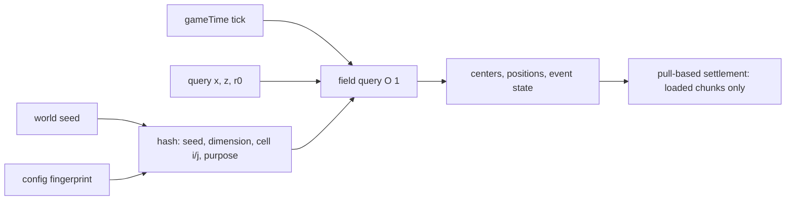

# Repository Guidelines

NeoForge 1.21.1 mod **Natural Disaster** (`naturaldisaster`): deterministic, simulation-free "disaster centers" whose positions are a pure function of `(world seed, gameTime, dimension, position)`. The field, per-level service, command and config are implemented; the algorithm and locked decisions live in `docs/天灾中心系统-设计与决策汇总.md`. That document is the single source of truth — when it conflicts with anything else, it wins.

## Project Overview

- **Goal:** O(1) point queries for whether/where a disaster center exists and whether a disaster is active — without ticking, saving, or simulating centers.
- **Core model:** static anchor grid (L1) + bounded home range (L2) + low-discrepancy Catmull–Rom roaming (L3), with a mandatory coarse displacement layer (`layers=2`).
- **Current status:** the Java field is implemented (`field/DisasterField`, deterministic hash, bounded home range, dual-layer roaming, pure event table). Center positions are quantized to 20-tick (1 s) steps and cached per step. `service/DisasterService` evaluates a chunk when `ChunkEvent.Load` fires, drops it on unload, and refreshes lazily when a motion step changes. `/disaster ison` reports the current loaded chunk's disaster state; `/disaster locate` scans a bounded center-grid neighbourhood for the nearest active disaster. Disaster **effects**, event kinds, and pull-based settlement are not implemented.
- Keep the design doc and code in sync. Algorithm/decision changes belong in the doc, then in code.

## Architecture & Data Flow

Target flow (field and loaded-chunk service implemented; effects still planned):

- **Pure function, no center state.** Never cache or persist center positions, event outcomes, or "already applied" flags. Rollback, multiplayer, and cross-dimension consistency depend on recomputation.
- **Layer composition:** `L = 1000 / sqrt(N)`; grid coords `(floor(x/L), floor(z/L))`. Anchor = cell center + hashed jitter in `[-0.3L, 0.3L]`. Home radius `R_c = kappa * L * sigma_c`, `sigma_c ∈ [0.85, 1.15]`; invariant `|P(c,t) - A_c| <= R_c`.
- **Dual layer is required by default:** coarse field at `coarseCells=8` scale, `coarseKappa=0.3`; add its displacement using the fine anchor's **static** coarse-cell ownership: `P = P_fine + v_B(t)`. Dynamic reassignment would teleport centers.
- **Query cost:** bounded candidate neighborhood `m = floor((R_max + r0)/L + 0.8)`; default `N=1`, `kappa=0.35`, `r0=4` gives a 3×3 grid. Never enumerate the world, all centers, or all history.
- **Effects (planned):** pull-based — each player/loaded-region rectangle queries nearby centers, expanded by the effect radius. Apply only to loaded chunks, aggregated per chunk (`k = floor(R_fx/16)` chunks); never per block. Do not retroactively simulate unloaded chunks. Multi-player: union rectangles, dedupe by center id; cost scales with disconnected regions, not player count.
- **Events (planned):** pure function of tick + center id (slot hash, per-center phase, at least one `Delta` between events), returning `{active, startTick, elapsed, remaining, radius, kind}`. No state machine.

### Non-negotiable determinism rules

1. Hash with 32-bit splitmix/Murmur-style mixing; inputs = seed words + dimension + cell coords + **separate purpose label** per use. Never reuse one random value for unrelated purposes.
2. Never use `Math.random`, `ThreadLocalRandom`, `Date`, system time, or identity hashes.
3. Runtime math is limited to IEEE-754 `+ - * /` and `sqrt`. No `sin/cos/tan/atan2/pow/exp/log/hypot/cbrt/fma` (cross-platform bit differences). Directions come from the hard-coded 1024-entry Q15 table.
4. Use mathematical floor for grid coordinates and ticks; negative coordinates/ticks must be tested (truncating division is a bug).
5. Use total world `gameTime`, **not** `dayTime` (wraps at 24000, command/sleep mutable).
6. Mix dimension id into the hash; dimensions have independent fields.
7. Config values form the **configuration fingerprint**, frozen at world creation. Exposed today: `centersPerKm2`, `kappa`, `walkSpeedBlocksPerTick`, `layers`, `disasterDurationSeconds`, `disasterRadiusChunks`. Design constants (event chance, segment factor, direction-table/algorithm version) must join the fingerprint as they are implemented. Changing any of them reshuffles every center / changes derived state.
8. Saves need only seed + config snapshot + current tick.

## Key Directories

| Path | Purpose |
|---|---|
|`src/main/java/com/fst/naturaldisaster/`|Entry point/config plus `field/` (pure deterministic field), `service/` (per-level field + loaded-chunk cache), `command/` (`/disaster ison`, `/disaster locate`).|
| `src/main/templates/META-INF/neoforge.mods.toml` | Mod metadata template; `${...}` placeholders expanded from `gradle.properties` into `build/generated/sources/modMetadata`. |
| `src/generated/resources/` | Datagen output; included in the main resource source set. Usually absent. |
| `docs/` | `天灾中心系统-设计与决策汇总.md` — authoritative design, decisions, limits, performance data. |
| `gradle/`, `gradlew`, `gradlew.bat` | Gradle 8.8 wrapper. Always use it; never install another Gradle. |
| `run/`, `run-data/`, `build/`, `.gradle/` | Generated runtime/build output. Do not edit. |

## Development Commands

Run from the repository root. On Windows use `gradlew.bat`; in Bash use `./gradlew`.

| Command | Purpose |
|---|---|
| `gradlew.bat compileJava` | Fast compile check after Java edits. |
| `gradlew.bat build` | Compile, expand resources, jar. Output: `build/libs/naturaldisaster-1.0.0.jar`. |
| `gradlew.bat runClient` | Dev client; working dir `run/`, debug logging. |
| `gradlew.bat runServer` | Dev dedicated server (`--nogui`); working dir `run/`. First run may stop for EULA; accept `run/eula.txt`. |
| `gradlew.bat runGameTestServer` | GameTest server (namespace `naturaldisaster`); currently zero tests. |
| `gradlew.bat runData` | Datagen → `src/generated/resources/`; working dir `run-data/`. |
| `gradlew.bat clean` | Reset build output (stock MDK workflow). |
| `gradlew.bat build --refresh-dependencies` | Force dependency refresh when caches are stale. |

There is no meaningful `test` or `lint` task; see Testing & QA.

## Code Conventions & Common Patterns

- **Package root:** `com.fst.naturaldisaster`. One mod, one base package; add subpackages by concern (field, event, client) as implementation grows.
- **Classes:** `final` unless a loader/API requires otherwise; private constructors for static holders (see `Config`). Naming: `PascalCase` classes, `camelCase` methods/fields, `UPPER_SNAKE_CASE` constants (`MODID`, `SPEC`, `INSTANCE`). Include units in config field names (`centersPerKm2`, `disasterDurationSeconds`).
- **Entry point:** `@Mod(NaturalDisaster.MODID)`; constructor takes `IEventBus` and `ModContainer` (FML constructor injection); `IEventBus` for lifecycle events (`FMLCommonSetupEvent`), `NeoForge.EVENT_BUS` for game events (`ServerStartingEvent`, `RegisterCommandsEvent`), `modContainer.registerConfig(ModConfig.Type.COMMON, Config.SPEC)`.
- **Config pattern:** static `Pair<Config, ModConfigSpec>` initialization; `private Config(ModConfigSpec.Builder)`; push a named section (`centers`); `defineInRange` for all numeric values. Comments must state world-fingerprint effects.
- **ID sync:** `NaturalDisaster.MODID` must match `mod_id` in `gradle.properties`; `neoforge.mods.toml` interpolates it. Changing the id means updating both places.
- **Logging:** `LogUtils.getLogger()` only; no `System.out`. Current smoke logs: `Natural Disaster common setup: ...` and `Natural Disaster attached to server instance`.
- **Encoding:** all Java compilation and resources are UTF-8; the design doc is Chinese — preserve encoding and existing terminology (disaster center, static anchor, home range/nest domain, coarse/fine layer, waypoint, active event, configuration fingerprint, pull-based settlement, chunk aggregation).
- **Side handling:** center/field queries are deterministic and server-authoritative; avoid client-only world state. Visual-only effects may use view distance; gameplay effects must use simulation distance.
- **Performance red lines:** no per-block effect application; no per-center tick simulation; no force-loading; no unbounded candidate scans. The coarse-layer prefilter is the known optimization for the ~18× dual-layer query cost.

## Important Files

| File | Why it matters |
|---|---|
| `src/main/java/com/fst/naturaldisaster/NaturalDisaster.java` | `@Mod` entry point; event-bus and config wiring; explicitly holds no center state. |
| `src/main/java/com/fst/naturaldisaster/Config.java` | Common config spec and default values; defines the world's configuration fingerprint. |
|`src/main/java/com/fst/naturaldisaster/field/DisasterField.java`|Pure field: anchor/home/roaming/dual layer/event table; positions quantized to 20-tick steps.|
| `src/main/java/com/fst/naturaldisaster/service/DisasterService.java` | Owns per-level field snapshots and the loaded-chunk disaster cache (`ChunkEvent.Load`/`Unload`). |
|`src/main/java/com/fst/naturaldisaster/command/DisasterCommands.java`|Registers `/disaster ison` (loaded chunk state) and `/disaster locate` (nearest active center in a bounded grid scan).|
| `src/main/templates/META-INF/neoforge.mods.toml` | Mod id/version/authors/dependencies; placeholders come from `gradle.properties`. |
| `gradle.properties` | Memory/caching flags, MC/NeoForge/mod versions and identity. |
| `build.gradle` | ModDevGradle setup, run configs, mod metadata expansion. |
| `settings.gradle` | Plugin repositories and root project name. |
| `docs/天灾中心系统-设计与决策汇总.md` | Authoritative algorithm, decisions, rejected approaches, performance bounds, current status. |

## Runtime/Tooling Preferences

- **JDK 21 is mandatory** (MC 1.21.1 bytecode). The build uses a Java 21 toolchain; `JAVA_HOME` must point at a JDK 21 (or a matching toolchain must be discoverable).
- **Gradle 8.8 via wrapper**; ModDevGradle `2.0.141`; Minecraft `1.21.1`; NeoForge `21.1.219`; Mojang mappings via NeoForm.
- NeoForge/NeoForm artifacts are shared through `~/.gradle/caches` (`neoformruntime`, `modules-2`); a rebuild of this project reuses them.
- Branch layout: `1.20.1` keeps the original Forge tree; `1.21.1neo` is the NeoForge port. Do not rewrite the `1.20.1` branch.
- No CI, no scripts beyond the Gradle wrappers.
- Build directories (`build/`, `.gradle/`, `run/`, `run-data/`) are disposable; never hand-edit generated files.

## Testing & QA

- **No automated tests exist:** no `src/test`, no GameTest classes/structures, no JUnit/test dependencies, no coverage, no lint/static analysis, no CI.
- `gradlew.bat test` is a valid Gradle task but executes zero mod tests; it does not boot Minecraft or exercise event/config wiring. Do not claim it verifies behavior.
- `runGameTestServer` is configured with `neoforge.enabledGameTestNamespaces=naturaldisaster`, so NeoForge GameTests will run if added. Place GameTest classes in the mod source set and register templates under the `naturaldisaster` namespace.
- **Manual smoke verification** (use this for current changes):
  1. `gradlew.bat runServer` (or `runClient`).
  2. Confirm the config log line with all six values and `Natural Disaster attached to server instance`.
  3. Check `run/logs/latest.log` for mod loading/config errors.
- The design doc's `node verify.js` (52 acceptance checks) is **not runnable here** — those files are absent. Treat its results as historical prototype evidence, not a command in this repo.
- When implementing the field/event layers, expect tests for: determinism across repeated calls, negative coordinates/ticks, large coordinates (~±3e7), exact density, boundedness `|P-A| <= R`, dual-layer composition, exact event duration and separation, and brute-force agreement for `exists`/`centersInRect`. Keep tests deterministic and independent of wall-clock time.
- **Coverage expectations:** none enforced. Add tests only for non-obvious invariants/edge cases; prefer GameTests for runtime behavior.
